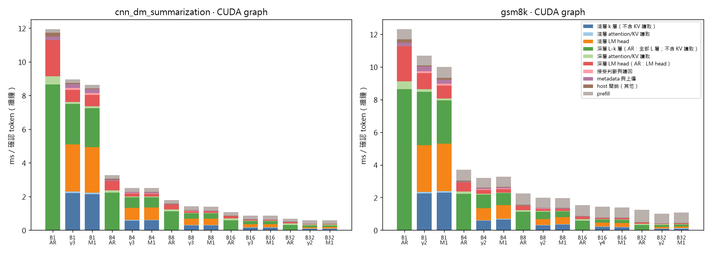
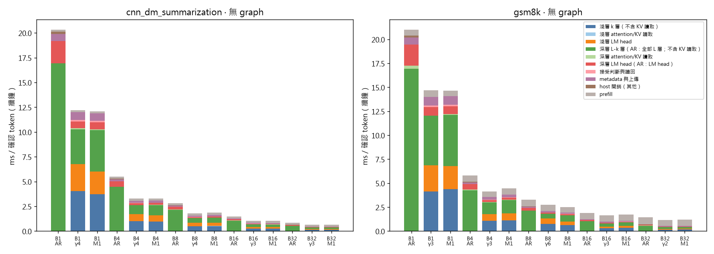
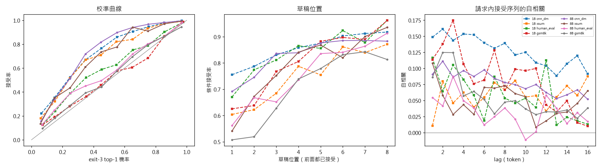

# 觀察 v3：時間花在哪裡、浪費在哪裡

RTX 4060 Laptop（8 GB，Windows），LayerSkip Llama3.2-1B 實機計時；LayerSkip Llama3-8B 與 1B 的輸出型分析。k = 3，bf16，greedy。程式在 commit `5ff0dba`；420 次計時執行都在 commit `0ece9aa`（乾淨工作樹，每個 run JSON 都記錄）。

**雜訊條件**：插電、Turbo 電源計畫；依你的指示直接開始，**Chrome、Discord、Steam、LINE 執行中沒有關閉**（`run_environment.json`）。每次執行用 nvidia-smi 每 500 ms 取樣：420 次執行各自的 SM 時脈中位數在 2565–2580 MHz，溫度最高 82 °C（每次執行的時脈最低值是執行開頭的閒置取樣）。每個點重複 3 次，報告中位數與四分位距（CSV 有 q1/q3）。

## 0. 結論

1. 有 CUDA Graph 後（launch 開銷占無 graph 時間的 24.0% 被消除），1B 每個確認 token 的時間主要是：深層驗證 31.3%、淺層 LM head 22.0%、prefill 21.8%、淺層 3 層 19.8%（10 格中位數）。
2. 前三名問題：淺層 LM head、prefill 暫停整批、淺層花在之後被拒的草稿。
3. 上限實驗：淺層 LM head 幾乎免費時吞吐量 +25.8%（+8.1%～+39.7%）；prefill 幾乎免費時 +23.3%（+0.1%～+135.7%，B 越大、輸出越短越高）；完美的驗證時機（m1-oracle）只有 1.2%（-8.4%～26.6%），低於 10%，**不值得做**——「淺層花在被拒草稿」的時間無法靠選擇驗證時機省下（淺層 step 在膝點以下，少算幾個 token 幾乎不省時間）。
4. 輸出型觀察（8B 與 1B）：草稿接受與 exit 信心值明顯相關、請求間差異大；批次聯集詞彙只需數千個 token（8B B = 32 最多 11151 個）；免費猜測只有 n-gram 在摘要任務有量，跨請求與被拒尾巴幾乎沒有。
5. 限制：時間型數據只來自 1B 與這台筆電（launch-bound、Windows），背景程式未關閉；8B 只有輸出型數據。

## 1. 問題排序（有 CUDA Graph；1B；cnn_dm、gsm8k × B = 1–32 共 10 格，每格取最佳同步 γ）

占比 = 該塊時間 ÷ 每確認 1 個 token 的牆鐘時間；理想上限 = 這塊完全消失時的吞吐量提升 1/(1−占比) − 1（**上限估算**，不是方法）。

| 排名 | 問題 | 占比 中位數（範圍） | 理想上限 中位數（最大） | 既有方法為何解決不了 | 批次化 early exit 的哪個特性有機會（C–F 數據） | 4090 + 8B 是否可能不同 |
|---|---|---|---|---|---|---|
| 1 | kernel 啟動開銷（無 graph − 有 graph）（既有方法已解決，不列入前三） | 24.0%（9.9%–31.4%） | +31.5%（+45.8%） | CUDA Graph 已解決（本表其他列都是有 graph 的數字）。 | — | 4090 + Linux 的 launch 開銷較小，但 eager 仍有。 |
| 2 | 淺層 LM head（每個草稿都乘一次 128k 詞彙的 lm_head） | 22.0%（8.9%–30.9%） | +28.2%（+44.7%） | LayerSkip 的 exit 共用完整的 lm_head；靜態的高頻子詞彙（如 FR-Spec）不隨批次內容改變，訓練小 head 則需要額外權重與訓練。 | F：8B 在 B = 16 時，聯集詞彙最大 9154 個（R/K/F = 64/32/4096，約 128k 的 7%），exit-3 限制在其中後 α_V/α 在最差任務為 0.978–1.009（下界–上界，2.7% 的位置 top-64 無法判定）；B = 32 時最大 11151 個、0.979–1.008。 | 8B 的 lm_head（1.05 GB）約等於 2.4 層 decoder 的權重，k = 3 時仍占淺層 step 讀取量的四成左右；4090 是頻寬受限，占比預期相近，不會因 launch 開銷消失而變小。 |
| 3 | prefill 暫停整批（separate prefill） | 21.8%（2.3%–58.8%） | +27.9%（+142.5%） | chunked prefill 只把 prefill 切開與 decode 混合，計算量不變；prefix cache 只省得了共用的前綴（few-shot 範例）。 | D：深層 step 的 token 數遠低於膝點（fixed-g4 B = 16 空位中位數 62 tokens，knee = 142），淺層段只有 B 個 token；同一步的空位可以容納 prompt token（舊 M3 的方向，在這台 GPU 上量到不划算）。 | 4090 上 8B 的 prefill 是 compute-bound（512 tokens 遠超膝點），decode 是頻寬受限；prefill 相對 decode 更貴，占比取決於輸出長度，短輸出任務（gsm8k）仍會很高。 |
| 4 | 淺層花在之後被拒的草稿 | 16.9%（7.1%–20.3%） | +20.4%（+25.5%） | 動態草稿長度（per-request）在批次中會讓深層幾乎每步都跑（觀察 O3）；同步批次只能整批共用 γ。 | C：exit-3 的信心值有校準力：8B top-1 機率 ≥ 0.5 時接受率 84%–97%，< 0.5 時 28%–49%；請求內 lag-1 自相關 0.05–0.11，請求間平均接受率 p10–p90 約 0.28–0.91。但淺層 step 在膝點以下，單一 slot 少算一個 token 幾乎不省時間，只有整批都停才省。 | 8B 的拒絕率更高（B_waste_ref：8B gsm8k γ = 4 有 71% 的草稿被拒），浪費比例預期更大。 |
| 5 | 深層花在被拒 token 上（按 token 比例分攤）（按比例分攤高估，不列入前三） | 7.9%（4.5%–10.7%） | +8.6%（+11.9%） | 驗證本來就要跑；被拒 token 在膝點以下幾乎不增加時間，按比例分攤高估了可省的量。 | D：深層 token 數低於膝點。 | 同左。 |
| 6 | attention / KV 讀取（隨 context 增加的部分） | 3.3%（2.4%–9.5%） | +3.4%（+10.5%） | —（context 512 時很小） | — | 長 context 時會變大。 |
| 7 | metadata 與上傳 | 2.3%（1.3%–2.7%） | +2.3%（+2.8%） | — | — | — |
| 8 | host 開銷（其他） | 1.0%（0.7%–1.5%） | +1.0%（+1.5%） | — | — | — |
| 9 | 接受判斷與讀回 | 0.9%（0.4%–1.3%） | +0.9%（+1.3%） | — | — | — |

不列入排序：**深層驗證本身**占 31.3%（19.1%–41.1%），是無損的代價；其中可省的部分就是上表的「深層花在被拒 token」。「kernel 啟動開銷」已被 CUDA Graph（既有方法）解決，「深層被拒 token」按比例分攤會高估可省的量，所以兩者不列入前三名。

重疊：「淺層 LM head」與「淺層花在被拒草稿」有交集（被拒草稿的 head 時間兩邊都算），兩者的上限不能相加。

**前三名**：1. 淺層 LM head（每個草稿都乘一次 128k 詞彙的 lm_head）（占比中位數 22.0%，理想上限 +28.2%）；2. prefill 暫停整批（separate prefill）（占比中位數 21.8%，理想上限 +27.9%）；3. 淺層花在之後被拒的草稿（占比中位數 16.9%，理想上限 +20.4%）

## 2. 前三名的上限實驗（實機，作弊版：只量速度上限，**不是方法**）

| 問題 | 作弊版 | 實測吞吐量提升 中位數（範圍，10 格 × 設定） | 判定 |
|---|---|---|---|
| 淺層 LM head | 淺層 head 只算 1024 列（argmax 丟棄），草稿從同一格的實際執行記錄重播；接受率與軌跡與真實執行相同 | 25.8%（8.1% – 39.7%） | 值得做（上限 ≥ 10%） |
| prefill | 完美 prefix cache：64 個 prompt 事先 prefill 一次存下 KV，執行中每次 prefill 只複製 KV | 23.3%（0.1% – 135.7%） | 值得做（上限 ≥ 10%） |
| 淺層花在被拒草稿（驗證時機） | m1-oracle：驗證時機用真實的接受長度（AR 參考輸出）決定 | 1.2%（-8.4% – 26.6%） | **不值得做**（上限 < 10%） |

逐格結果（基準 = 同一格、同設定、有 graph 的 budget 執行，3 次中位數；括號為四分位距）：

| 作弊版 | 任務 | B | 設定 | 基準 tok/s | 作弊 tok/s | 提升 | 接受率 | 備註 |
|---|---|---|---|---|---|---|---|---|
| head | cnn_dm | 1 | fixed-g3 | 111（110–112） | 155（154–157） | 39.7% | 0.672 | 重播缺值 0.2%（只發生在已結束請求的最後一輪） |
| head | cnn_dm | 1 | m1 | 115（115–116） | 161（160–162） | 39.4% | 0.708 | 重播缺值 1.1%（只發生在已結束請求的最後一輪） |
| oracle | cnn_dm | 1 | m1 | 115（115–116） | 146（146–148） | 26.6% | 0.911 | oracle 涵蓋率 84% |
| prefill | cnn_dm | 1 | fixed-g3 | 111（110–112） | 111（111–112） | 0.6% | 0.672 |  |
| prefill | cnn_dm | 1 | m1 | 115（115–116） | 116（110–116） | 0.1% | 0.708 |  |
| head | cnn_dm | 4 | fixed-g3 | 397（396–400） | 523（511–527） | 31.6% | 0.652 | 重播缺值 0.2%（只發生在已結束請求的最後一輪） |
| head | cnn_dm | 4 | m1 | 396（396–398） | 544（538–544） | 37.2% | 0.654 | 重播缺值 0.4%（只發生在已結束請求的最後一輪） |
| oracle | cnn_dm | 4 | m1 | 396（396–398） | 402（393–411） | 1.5% | 0.663 | oracle 涵蓋率 76% |
| prefill | cnn_dm | 4 | fixed-g3 | 397（396–400） | 425（425–428） | 7.1% | 0.661 |  |
| prefill | cnn_dm | 4 | m1 | 396（396–398） | 424（423–424） | 7.0% | 0.650 |  |
| head | cnn_dm | 8 | fixed-g3 | 699（694–712） | 903（890–909） | 29.1% | 0.673 | 重播缺值 0.2%（只發生在已結束請求的最後一輪） |
| head | cnn_dm | 8 | m1 | 697（696–724） | 902（900–955） | 29.5% | 0.652 | 重播缺值 0.4%（只發生在已結束請求的最後一輪） |
| oracle | cnn_dm | 8 | m1 | 697（696–724） | 703（684–711） | 0.9% | 0.648 | oracle 涵蓋率 71% |
| prefill | cnn_dm | 8 | fixed-g3 | 699（694–712） | 823（819–844） | 17.7% | 0.671 |  |
| prefill | cnn_dm | 8 | m1 | 697（696–724） | 821（814–825） | 17.8% | 0.660 |  |
| head | cnn_dm | 16 | fixed-g3 | 1158（1142–1160） | 1376（1198–1426） | 18.8% | 0.669 | 重播缺值 0.2%（只發生在已結束請求的最後一輪） |
| head | cnn_dm | 16 | m1 | 1159（1152–1172） | 1390（1367–1449） | 20.0% | 0.649 | 重播缺值 0.3%（只發生在已結束請求的最後一輪） |
| oracle | cnn_dm | 16 | m1 | 1159（1152–1172） | 1144（1137–1148） | -1.3% | 0.618 | oracle 涵蓋率 75% |
| prefill | cnn_dm | 16 | fixed-g3 | 1158（1142–1160） | 1452（1407–1474） | 25.3% | 0.669 |  |
| prefill | cnn_dm | 16 | m1 | 1159（1152–1172） | 1516（1420–1523） | 30.8% | 0.661 |  |
| head | cnn_dm | 32 | fixed-g2 | 1710（1700–1720） | 1935（1923–1943） | 13.1% | 0.740 | 重播缺值 0.1%（只發生在已結束請求的最後一輪） |
| head | cnn_dm | 32 | m1 | 1725（1718–1748） | 1975（1967–2011） | 14.5% | 0.672 | 重播缺值 0.2%（只發生在已結束請求的最後一輪） |
| oracle | cnn_dm | 32 | m1 | 1725（1718–1748） | 1648（1636–1679） | -4.5% | 0.658 | oracle 涵蓋率 76% |
| prefill | cnn_dm | 32 | fixed-g2 | 1710（1700–1720） | 2506（2500–2506） | 46.5% | 0.740 |  |
| prefill | cnn_dm | 32 | m1 | 1725（1718–1748） | 2558（2555–2582） | 48.3% | 0.672 |  |
| head | gsm8k | 1 | fixed-g2 | 93（93–95） | 122（121–124） | 30.7% | 0.611 | 重播缺值 0.6%（只發生在已結束請求的最後一輪） |
| head | gsm8k | 1 | m1 | 100（98–103） | 136（133–143） | 36.0% | 0.636 | 重播缺值 1.5%（只發生在已結束請求的最後一輪） |
| oracle | gsm8k | 1 | m1 | 100（98–103） | 115（115–119） | 15.6% | 0.818 | oracle 涵蓋率 86% |
| prefill | gsm8k | 1 | fixed-g2 | 93（93–95） | 95（95–97） | 2.0% | 0.611 |  |
| prefill | gsm8k | 1 | m1 | 100（98–103） | 104（103–108） | 3.9% | 0.633 |  |
| head | gsm8k | 4 | fixed-g2 | 316（297–318） | 412（377–414） | 30.6% | 0.652 | 重播缺值 0.7%（只發生在已結束請求的最後一輪） |
| head | gsm8k | 4 | m1 | 301（295–312） | 381（378–414） | 26.6% | 0.529 | 重播缺值 1.5%（只發生在已結束請求的最後一輪） |
| oracle | gsm8k | 4 | m1 | 301（295–312） | 317（299–327） | 5.2% | 0.575 | oracle 涵蓋率 84% |
| prefill | gsm8k | 4 | fixed-g2 | 316（297–318） | 383（366–387） | 21.3% | 0.652 |  |
| prefill | gsm8k | 4 | m1 | 301（295–312） | 362（360–377） | 20.2% | 0.521 |  |
| head | gsm8k | 8 | fixed-g2 | 493（460–502） | 585（530–620） | 18.7% | 0.586 | 重播缺值 0.7%（只發生在已結束請求的最後一輪） |
| head | gsm8k | 8 | m1 | 508（494–513） | 602（590–622） | 18.4% | 0.519 | 重播缺值 1.2%（只發生在已結束請求的最後一輪） |
| oracle | gsm8k | 8 | m1 | 508（494–513） | 466（446–495） | -8.4% | 0.527 | oracle 涵蓋率 89% |
| prefill | gsm8k | 8 | fixed-g2 | 493（460–502） | 706（679–707） | 43.2% | 0.609 |  |
| prefill | gsm8k | 8 | m1 | 508（494–513） | 713（685–717） | 40.2% | 0.533 |  |
| head | gsm8k | 16 | fixed-g4 | 700（668–717） | 844（808–879） | 20.6% | 0.487 | 重播缺值 1.6%（只發生在已結束請求的最後一輪） |
| head | gsm8k | 16 | m1 | 697（676–721） | 871（807–885） | 24.9% | 0.520 | 重播缺值 1.2%（只發生在已結束請求的最後一輪） |
| oracle | gsm8k | 16 | m1 | 697（676–721） | 724（679–727） | 3.8% | 0.531 | oracle 涵蓋率 82% |
| prefill | gsm8k | 16 | fixed-g4 | 700（668–717） | 1233（1193–1236） | 76.1% | 0.488 |  |
| prefill | gsm8k | 16 | m1 | 697（676–721） | 1267（1228–1283） | 81.7% | 0.518 |  |
| head | gsm8k | 32 | fixed-g2 | 973（969–997） | 1052（1046–1073） | 8.1% | 0.648 | 重播缺值 0.7%（只發生在已結束請求的最後一輪） |
| head | gsm8k | 32 | m1 | 922（909–925） | 999（988–1003） | 8.4% | 0.538 | 重播缺值 1.0%（只發生在已結束請求的最後一輪） |
| oracle | gsm8k | 32 | m1 | 922（909–925） | 904（879–947） | -2.0% | 0.570 | oracle 涵蓋率 84% |
| prefill | gsm8k | 32 | fixed-g2 | 973（969–997） | 2233（2227–2250） | 129.4% | 0.648 |  |
| prefill | gsm8k | 32 | m1 | 922（909–925） | 2173（2148–2186） | 135.7% | 0.538 |  |

## 3. 觀察

### A. 時間預算（1B，實機）

每確認 1 個 token 的牆鐘時間拆解（ms，3 次中位數）。最佳 γ = 同格 γ ∈ {2,3,4,6,8} 中牆鐘吞吐量最高者。

**有 CUDA Graph**

| 任務 | B | 設定 | tok/s（IQR） | ms/token | 淺層 k 層 | 淺層 KV | 淺層 head | 深層 L−k 層 | 深層 KV | 深層 head | 接受+讀回 | metadata | host | prefill |
|---|---|---|---|---|---|---|---|---|---|---|---|---|---|---|
| cnn_dm | 1 | ar | 84（84–84） | 11.967 | 0% | 0% | 0% | 72% | 4% | 18% | 0% | 2% | 2% | 2% |
| cnn_dm | 1 | fixed-g3 | 111（110–112） | 9.040 | 24% | 1% | 31% | 27% | 1% | 8% | 1% | 3% | 1% | 2% |
| cnn_dm | 1 | m1 | 115（115–116） | 8.669 | 25% | 1% | 31% | 27% | 1% | 8% | 1% | 3% | 1% | 3% |
| cnn_dm | 4 | ar | 306（304–307） | 3.267 | 0% | 0% | 0% | 68% | 4% | 17% | 0% | 2% | 2% | 7% |
| cnn_dm | 4 | fixed-g3 | 397（396–400） | 2.517 | 23% | 1% | 29% | 25% | 2% | 7% | 1% | 2% | 1% | 9% |
| cnn_dm | 4 | m1 | 396（396–398） | 2.524 | 23% | 2% | 29% | 24% | 2% | 7% | 1% | 2% | 1% | 9% |
| cnn_dm | 8 | ar | 558（557–560） | 1.791 | 0% | 0% | 0% | 63% | 5% | 15% | 0% | 1% | 2% | 12% |
| cnn_dm | 8 | fixed-g3 | 699（694–712） | 1.430 | 20% | 2% | 25% | 23% | 2% | 6% | 1% | 2% | 1% | 16% |
| cnn_dm | 8 | m1 | 697（696–724） | 1.435 | 20% | 2% | 26% | 22% | 2% | 6% | 1% | 2% | 1% | 16% |
| cnn_dm | 16 | ar | 928（923–929） | 1.078 | 0% | 0% | 0% | 54% | 10% | 13% | 0% | 1% | 3% | 19% |
| cnn_dm | 16 | fixed-g3 | 1158（1142–1160） | 0.863 | 17% | 3% | 21% | 20% | 4% | 6% | 1% | 2% | 1% | 25% |
| cnn_dm | 16 | m1 | 1159（1152–1172） | 0.863 | 17% | 3% | 21% | 19% | 3% | 5% | 1% | 2% | 1% | 26% |
| cnn_dm | 32 | ar | 1454（1451–1455） | 0.688 | 0% | 0% | 0% | 45% | 14% | 10% | 0% | 1% | 3% | 26% |
| cnn_dm | 32 | fixed-g2 | 1710（1700–1720） | 0.585 | 12% | 4% | 14% | 20% | 6% | 5% | 1% | 2% | 1% | 34% |
| cnn_dm | 32 | m1 | 1725（1718–1748） | 0.580 | 13% | 4% | 16% | 18% | 5% | 5% | 1% | 2% | 1% | 35% |
| gsm8k | 1 | ar | 81（81–81） | 12.296 | 0% | 0% | 0% | 70% | 4% | 18% | 0% | 2% | 2% | 5% |
| gsm8k | 1 | fixed-g2 | 93（93–95） | 10.723 | 21% | 1% | 27% | 31% | 2% | 9% | 1% | 3% | 1% | 6% |
| gsm8k | 1 | m1 | 100（98–103） | 10.020 | 23% | 1% | 29% | 26% | 1% | 8% | 1% | 3% | 1% | 7% |
| gsm8k | 4 | ar | 261（259–271） | 3.831 | 0% | 0% | 0% | 58% | 4% | 14% | 0% | 1% | 2% | 17% |
| gsm8k | 4 | fixed-g2 | 316（297–318） | 3.169 | 18% | 1% | 23% | 26% | 2% | 8% | 1% | 2% | 1% | 19% |
| gsm8k | 4 | m1 | 301（295–312） | 3.323 | 20% | 1% | 25% | 22% | 1% | 6% | 1% | 2% | 1% | 19% |
| gsm8k | 8 | ar | 434（411–460） | 2.307 | 0% | 0% | 0% | 49% | 4% | 12% | 0% | 1% | 2% | 30% |
| gsm8k | 8 | fixed-g2 | 493（460–502） | 2.028 | 15% | 1% | 18% | 22% | 2% | 6% | 1% | 2% | 1% | 31% |
| gsm8k | 8 | m1 | 508（494–513） | 1.967 | 17% | 1% | 22% | 19% | 1% | 5% | 1% | 2% | 1% | 31% |
| gsm8k | 16 | ar | 635（632–645） | 1.574 | 0% | 0% | 0% | 37% | 6% | 9% | 0% | 1% | 2% | 42% |
| gsm8k | 16 | fixed-g4 | 700（668–717） | 1.428 | 13% | 2% | 16% | 14% | 2% | 4% | 1% | 2% | 1% | 45% |
| gsm8k | 16 | m1 | 697（676–721） | 1.434 | 12% | 2% | 15% | 14% | 2% | 4% | 1% | 2% | 1% | 45% |
| gsm8k | 32 | ar | 784（782–804） | 1.276 | 0% | 0% | 0% | 24% | 6% | 6% | 0% | 1% | 2% | 59% |
| gsm8k | 32 | fixed-g2 | 973（969–997） | 1.028 | 8% | 2% | 9% | 12% | 3% | 3% | 0% | 1% | 1% | 59% |
| gsm8k | 32 | m1 | 922（909–925） | 1.084 | 8% | 2% | 10% | 11% | 3% | 3% | 0% | 1% | 1% | 60% |

**沒有 graph**

| 任務 | B | 設定 | tok/s（IQR） | ms/token | 淺層 k 層 | 淺層 KV | 淺層 head | 深層 L−k 層 | 深層 KV | 深層 head | 接受+讀回 | metadata | host | prefill |
|---|---|---|---|---|---|---|---|---|---|---|---|---|---|---|
| cnn_dm | 1 | ar | 49（48–49） | 20.467 | 0% | 0% | 0% | 83% | 0% | 11% | 0% | 4% | 1% | 1% |
| cnn_dm | 1 | fixed-g4 | 81（80–82） | 12.419 | 32% | 0% | 22% | 28% | 1% | 5% | 1% | 6% | 0% | 2% |
| cnn_dm | 1 | m1 | 81（81–83） | 12.304 | 30% | 0% | 18% | 34% | 1% | 6% | 1% | 6% | 0% | 2% |
| cnn_dm | 4 | ar | 182（179–185） | 5.499 | 0% | 0% | 0% | 81% | 0% | 10% | 0% | 3% | 1% | 4% |
| cnn_dm | 4 | fixed-g4 | 305（303–305） | 3.280 | 30% | 0% | 21% | 28% | 0% | 5% | 1% | 7% | 0% | 7% |
| cnn_dm | 4 | m1 | 299（298–299） | 3.346 | 29% | 0% | 19% | 31% | 1% | 5% | 1% | 7% | 0% | 6% |
| cnn_dm | 8 | ar | 359（349–363） | 2.787 | 0% | 0% | 0% | 77% | 2% | 10% | 0% | 3% | 2% | 8% |
| cnn_dm | 8 | fixed-g4 | 567（549–576） | 1.763 | 29% | 0% | 20% | 26% | 1% | 5% | 1% | 7% | 0% | 13% |
| cnn_dm | 8 | m1 | 543（542–546） | 1.841 | 27% | 1% | 17% | 30% | 0% | 5% | 1% | 7% | 0% | 12% |
| cnn_dm | 16 | ar | 681（649–682） | 1.468 | 0% | 0% | 0% | 71% | 2% | 10% | 0% | 3% | 2% | 14% |
| cnn_dm | 16 | fixed-g3 | 965（953–965） | 1.037 | 24% | 0% | 15% | 27% | 1% | 5% | 1% | 8% | 0% | 20% |
| cnn_dm | 16 | m1 | 977（951–980） | 1.023 | 24% | 0% | 15% | 25% | 0% | 5% | 1% | 8% | 0% | 21% |
| cnn_dm | 32 | ar | 1180（1179–1199） | 0.848 | 0% | 0% | 0% | 61% | 0% | 9% | 0% | 3% | 3% | 21% |
| cnn_dm | 32 | fixed-g3 | 1502（1500–1511） | 0.666 | 20% | 0% | 11% | 21% | 2% | 4% | 1% | 9% | 0% | 32% |
| cnn_dm | 32 | m1 | 1503（1493–1522） | 0.665 | 20% | 0% | 11% | 21% | 2% | 4% | 1% | 9% | 0% | 31% |
| gsm8k | 1 | ar | 48（47–48） | 20.930 | 0% | 0% | 0% | 81% | 1% | 11% | 0% | 3% | 1% | 3% |
| gsm8k | 1 | fixed-g3 | 67（65–69） | 14.944 | 28% | 0% | 18% | 34% | 0% | 6% | 1% | 6% | 0% | 5% |
| gsm8k | 1 | m1 | 68（59–69） | 14.649 | 30% | 0% | 16% | 37% | 0% | 6% | 1% | 6% | 0% | 4% |
| gsm8k | 4 | ar | 170（150–175） | 5.868 | 0% | 0% | 0% | 72% | 2% | 10% | 0% | 3% | 1% | 11% |
| gsm8k | 4 | fixed-g3 | 240（202–243） | 4.158 | 26% | 0% | 16% | 29% | 1% | 5% | 1% | 6% | 0% | 14% |
| gsm8k | 4 | m1 | 221（202–223） | 4.517 | 25% | 0% | 16% | 31% | 0% | 5% | 1% | 6% | 0% | 14% |
| gsm8k | 8 | ar | 276（260–305） | 3.623 | 0% | 0% | 0% | 59% | 0% | 8% | 0% | 3% | 1% | 19% |
| gsm8k | 8 | fixed-g6 | 358（323–367） | 2.790 | 26% | 0% | 21% | 18% | 0% | 4% | 1% | 6% | 0% | 23% |
| gsm8k | 8 | m1 | 396（360–397） | 2.522 | 24% | 0% | 15% | 26% | 0% | 4% | 1% | 6% | 0% | 23% |
| gsm8k | 16 | ar | 508（463–516） | 1.970 | 0% | 0% | 0% | 52% | 0% | 7% | 0% | 2% | 2% | 33% |
| gsm8k | 16 | fixed-g3 | 582（537–597） | 1.718 | 17% | 0% | 11% | 18% | 1% | 4% | 1% | 6% | 0% | 40% |
| gsm8k | 16 | m1 | 557（516–608） | 1.794 | 18% | 1% | 10% | 21% | 0% | 3% | 1% | 6% | 0% | 35% |
| gsm8k | 32 | ar | 699（608–712） | 1.430 | 0% | 0% | 0% | 37% | 3% | 5% | 0% | 2% | 2% | 52% |
| gsm8k | 32 | fixed-g2 | 877（757–902） | 1.141 | 12% | 1% | 6% | 17% | 1% | 3% | 1% | 6% | 0% | 53% |
| gsm8k | 32 | m1 | 827（758–834） | 1.209 | 14% | 0% | 7% | 14% | 1% | 3% | 0% | 7% | 0% | 53% |

這代表：有 graph 時，淺層 LM head 比淺層 3 層本身還貴（每個草稿都乘 128k × 2048 的 lm_head）；B ≥ 16 時 prefill 是最大的單一塊；host 開銷只剩約 1.0%。沒有 graph 時，每 token 時間中有 24.0%（9.9%–31.4%）在有 graph 時消失，這就是 kernel 啟動開銷。AR 的「深層」欄是全部 L 層。KV 讀取用同一 segment 在 L = 64 與最大 L 兩點實測的斜率推得；無 graph 時 launch-bound，斜率量到約 0。

### B. 浪費的拆解

1B 實機回合記錄（有 graph，3 次中位數）：

| 任務 | B | 設定 | 淺層時間花在被拒草稿 | 草稿全接受卻停下的輪次 | 深層被拒 token（時間） | 每輪淺層 step（每 slot） |
|---|---|---|---|---|---|---|
| cnn_dm | 1 | fixed-g3 | 35.8% | 55.5% | 24.6%（24.5%） | 3.00 |
| cnn_dm | 1 | m1 | 32.3% | 56.8% | 21.7%（23.1%） | 3.08 |
| cnn_dm | 4 | fixed-g3 | 36.5% | 54.9% | 25.3%（25.3%） | 3.00 |
| cnn_dm | 4 | m1 | 37.3% | 54.3% | 26.7%（26.4%） | 3.32 |
| cnn_dm | 8 | fixed-g3 | 35.4% | 56.2% | 24.5%（24.4%） | 3.00 |
| cnn_dm | 8 | m1 | 36.5% | 54.6% | 26.0%（25.7%） | 3.31 |
| cnn_dm | 16 | fixed-g3 | 35.6% | 56.4% | 24.7%（24.7%） | 3.00 |
| cnn_dm | 16 | m1 | 36.4% | 54.0% | 26.0%（26.2%） | 3.39 |
| cnn_dm | 32 | fixed-g2 | 28.1% | 67.6% | 17.3%（17.3%） | 2.00 |
| cnn_dm | 32 | m1 | 35.4% | 56.7% | 24.4%（24.4%） | 3.00 |
| gsm8k | 1 | fixed-g2 | 41.9% | 52.2% | 26.0%（25.9%） | 2.00 |
| gsm8k | 1 | m1 | 40.2% | 47.0% | 26.3%（28.3%） | 2.81 |
| gsm8k | 4 | fixed-g2 | 41.0% | 53.8% | 25.7%（25.6%） | 2.00 |
| gsm8k | 4 | m1 | 50.6% | 41.2% | 35.1%（34.3%） | 3.17 |
| gsm8k | 8 | fixed-g2 | 41.7% | 52.8% | 26.1%（26.0%） | 2.00 |
| gsm8k | 8 | m1 | 49.0% | 42.3% | 35.6%（35.0%） | 3.28 |
| gsm8k | 16 | fixed-g4 | 53.8% | 36.0% | 41.1%（41.0%） | 4.00 |
| gsm8k | 16 | m1 | 50.5% | 41.1% | 37.0%（36.5%） | 3.34 |
| gsm8k | 32 | fixed-g2 | 37.9% | 56.8% | 23.6%（23.5%） | 2.00 |
| gsm8k | 32 | m1 | 49.1% | 42.0% | 34.3%（34.2%） | 2.95 |

AR 參考輸出上的同步 γ 回合（8B 與 1B，四個任務；輸出型）：

| 模型 | 任務 | γ | 被拒草稿 | 全接受卻停下的輪次 | 深層被拒 token | 每輪確認 |
|---|---|---|---|---|---|---|
| 1B | cnn_dm | 2 | 25.4% | 68.1% | 16.9% | 2.49 |
| 1B | cnn_dm | 4 | 37.9% | 49.0% | 30.3% | 3.47 |
| 1B | cnn_dm | 8 | 55.3% | 28.6% | 49.1% | 4.52 |
| 1B | xsum | 2 | 44.5% | 45.0% | 29.5% | 2.10 |
| 1B | xsum | 4 | 59.6% | 25.4% | 47.3% | 2.56 |
| 1B | xsum | 8 | 74.3% | 11.4% | 65.3% | 2.87 |
| 1B | human_eval | 2 | 31.3% | 62.9% | 20.8% | 2.36 |
| 1B | human_eval | 4 | 43.9% | 44.3% | 34.8% | 3.16 |
| 1B | human_eval | 8 | 60.1% | 26.8% | 52.9% | 3.93 |
| 1B | gsm8k | 2 | 39.4% | 52.1% | 26.1% | 2.20 |
| 1B | gsm8k | 4 | 54.4% | 32.9% | 43.2% | 2.76 |
| 1B | gsm8k | 8 | 69.3% | 18.9% | 60.9% | 3.23 |
| 8B | cnn_dm | 2 | 31.2% | 61.4% | 20.8% | 2.37 |
| 8B | cnn_dm | 4 | 44.7% | 41.9% | 35.7% | 3.19 |
| 8B | cnn_dm | 8 | 61.1% | 22.5% | 54.2% | 4.04 |
| 8B | xsum | 2 | 44.3% | 48.2% | 29.4% | 2.10 |
| 8B | xsum | 4 | 59.5% | 28.9% | 47.2% | 2.56 |
| 8B | xsum | 8 | 72.9% | 16.1% | 63.9% | 2.94 |
| 8B | human_eval | 2 | 46.5% | 45.8% | 30.8% | 2.05 |
| 8B | human_eval | 4 | 61.2% | 24.0% | 48.5% | 2.48 |
| 8B | human_eval | 8 | 75.5% | 12.5% | 66.3% | 2.77 |
| 8B | gsm8k | 2 | 56.0% | 32.6% | 37.3% | 1.88 |
| 8B | gsm8k | 4 | 71.1% | 15.3% | 56.8% | 2.14 |
| 8B | gsm8k | 8 | 83.2% | 7.1% | 73.6% | 2.30 |

這代表：同步 γ 同時有兩種浪費（範圍涵蓋所有 γ 與 M1、兩個任務、所有 B）——28%–74% 的淺層時間花在之後被拒的草稿上，同時又有 15%–68% 的輪次在草稿全對時停下；γ 調小減少前者、增加後者，單一 γ 無法同時減少兩者（M1 也一樣）。γ = 4 時被拒草稿 8B 為 45%–71%，1B 為 38%–60%。

### C. 接受的結構（輸出型，exit 3）

| 模型 | 任務 | α（exit 3） | 位置 1 / 2 / 4 / 8 的條件接受率 | top-1 ≥ 0.5 的接受率（占比） | < 0.5 的接受率 | ECE | lag-1 自相關 | 請求平均接受率 p10–p90 |
|---|---|---|---|---|---|---|---|---|
| 1B | cnn_dm | 0.838 | 76% / 79% / 86% / 92% | 97%（71%） | 50% | 0.140 | 0.15 | 0.56–0.93 |
| 1B | xsum | 0.685 | 60% / 62% / 79% / 87% | 95%（48%） | 44% | 0.163 | 0.01 | 0.38–0.87 |
| 1B | human_eval | 0.805 | 67% / 77% / 87% / 96% | 93%（77%） | 41% | 0.049 | 0.12 | 0.38–0.93 |
| 1B | gsm8k | 0.745 | 63% / 64% / 81% / 96% | 91%（74%） | 29% | 0.020 | 0.11 | 0.35–0.93 |
| 8B | cnn_dm | 0.802 | 69% / 75% / 84% / 88% | 97%（65%） | 49% | 0.170 | 0.09 | 0.40–0.91 |
| 8B | xsum | 0.706 | 54% / 67% / 84% / 94% | 96%（55%） | 40% | 0.139 | 0.11 | 0.33–0.91 |
| 8B | human_eval | 0.676 | 56% / 67% / 74% / 91% | 87%（62%） | 35% | 0.050 | 0.05 | 0.28–0.78 |
| 8B | gsm8k | 0.589 | 51% / 52% / 74% / 81% | 84%（55%） | 28% | 0.029 | 0.09 | 0.41–0.67 |

token 類型（AR token 的類別 → 接受率；占比）：

| 模型 | 任務 | 一般詞 | 標點 | 數字 | 空白/換行 | 出現在 prompt | 不在 prompt |
|---|---|---|---|---|---|---|---|
| 1B | cnn_dm | 83%（85%） | 86%（10%） | 81%（3%） | 89%（2%） | 85%（88%） | 77%（12%） |
| 1B | gsm8k | 76%（35%） | 68%（24%） | 64%（24%） | 95%（17%） | 77%（93%） | 42%（7%） |
| 1B | human_eval | 74%（39%） | 80%（29%） | 73%（10%） | 96%（22%） | 83%（54%） | 77%（46%） |
| 1B | xsum | 69%（87%） | 64%（10%） | 72%（2%） | 80%（1%） | 72%（80%） | 54%（20%） |
| 8B | cnn_dm | 79%（84%） | 87%（13%） | 76%（2%） | 81%（1%） | 83%（90%） | 51%（10%） |
| 8B | gsm8k | 66%（41%） | 57%（24%） | 34%（23%） | 87%（12%） | 64%（86%） | 29%（14%） |
| 8B | human_eval | 56%（44%） | 67%（26%） | 74%（11%） | 92%（19%） | 75%（53%） | 60%（47%） |
| 8B | xsum | 71%（84%） | 68%（10%） | 68%（3%） | 69%（2%） | 75%（82%） | 48%（18%） |

退出層 k = 2..8 的 α：

| 模型 | 任務 | k=2 | k=3 | k=4 | k=5 | k=6 | k=7 | k=8 |
|---|---|---|---|---|---|---|---|---|
| 1B | cnn_dm | 0.411 | 0.838 | 0.846 | 0.841 | 0.929 | 0.932 | 0.939 |
| 1B | gsm8k | 0.598 | 0.745 | 0.745 | 0.766 | 0.830 | 0.835 | 0.844 |
| 1B | human_eval | 0.698 | 0.805 | 0.823 | 0.838 | 0.870 | 0.873 | 0.882 |
| 1B | xsum | 0.406 | 0.685 | 0.691 | 0.706 | 0.790 | 0.801 | 0.813 |
| 8B | cnn_dm | 0.279 | 0.802 | 0.811 | 0.815 | 0.887 | 0.894 | 0.896 |
| 8B | gsm8k | 0.253 | 0.589 | 0.597 | 0.591 | 0.679 | 0.692 | 0.695 |
| 8B | human_eval | 0.467 | 0.676 | 0.696 | 0.717 | 0.766 | 0.780 | 0.785 |
| 8B | xsum | 0.323 | 0.706 | 0.718 | 0.717 | 0.778 | 0.789 | 0.792 |

這代表：接受不是均勻的。前面都接受時，越後面的草稿條件接受率越高；exit 的 top-1 機率能把 token 分成高接受（≥ 0.5：84%–97%，8B）與低接受（< 0.5：28%–49%）兩群；請求間差異大（請求平均接受率 p10–p90 跨 0.28–0.93），請求內的自相關很弱（lag-1 為 0.01–0.15）；出現在 prompt 中的 token 在每個任務都較容易接受，8B 在 gsm8k 的數字 token 只有 34% 被接受。exit 6 的 α 比 exit 3 高 0.06–0.09，但 exit 2 很差。

### D. 空位（1B，實機記錄）

knee_measured = 142 tokens（這台 GPU 的校準）。

| 任務 | B | 設定 | 淺層段 token 中位數 | 深層段 token 中位數（p10–p90） | 深層空位中位數（p10–p90） | 深層超過膝點 |
|---|---|---|---|---|---|---|
| cnn_dm | 1 | fixed-g4 | 1 | 5（5–5） | 137（137–137） | 0% |
| cnn_dm | 1 | m1 | 1 | 4（2–7） | 138（135–140） | 0% |
| cnn_dm | 4 | fixed-g4 | 4 | 20（20–20） | 122（122–122） | 0% |
| cnn_dm | 4 | m1 | 4 | 16（12–24） | 126（118–130） | 0% |
| cnn_dm | 8 | fixed-g4 | 8 | 40（40–40） | 102（102–102） | 0% |
| cnn_dm | 8 | m1 | 8 | 40（24–50） | 102（92–118） | 0% |
| cnn_dm | 16 | fixed-g4 | 16 | 80（80–80） | 62（62–62） | 0% |
| cnn_dm | 16 | m1 | 16 | 64（48–80） | 78（62–94） | 0% |
| cnn_dm | 32 | fixed-g4 | 32 | 160（160–160） | -18（-18–-18） | 100% |
| cnn_dm | 32 | m1 | 32 | 128（128–128） | 14（14–14） | 1% |
| gsm8k | 1 | fixed-g4 | 1 | 5（5–5） | 137（137–137） | 0% |
| gsm8k | 1 | m1 | 1 | 3（2–7） | 139（135–140） | 0% |
| gsm8k | 4 | fixed-g4 | 4 | 20（20–20） | 122（122–122） | 0% |
| gsm8k | 4 | m1 | 4 | 16（9–23） | 126（119–133） | 0% |
| gsm8k | 8 | fixed-g4 | 8 | 40（40–40） | 102（102–102） | 0% |
| gsm8k | 8 | m1 | 8 | 32（24–48） | 110（94–118） | 0% |
| gsm8k | 16 | fixed-g4 | 16 | 80（80–80） | 62（62–62） | 0% |
| gsm8k | 16 | m1 | 16 | 64（48–112） | 78（30–94） | 0% |
| gsm8k | 32 | fixed-g4 | 32 | 160（160–160） | -18（-18–-18） | 100% |
| gsm8k | 32 | m1 | 32 | 128（128–128） | 14（14–14） | 0% |

這代表：淺層段永遠只有 B 個 token，離膝點很遠；深層段在 B ≤ 16 時也有幾十到一百多個 token 的空位，B = 32 + γ = 4 才超過膝點。

### E. 免費猜測的命中率（輸出型；只在草稿全接受的輪次後接猜測，同步 γ = 4）

| 模型 | 任務 | 來源 | G | 全接受輪次 | 每輪多確認 | 排除重複迴圈請求後 |
|---|---|---|---|---|---|---|
| 1B | cnn_dm | ngram | 4 | 48% | 1.779 | 1.427 |
| 1B | cnn_dm | cross_request_B16 | 4 | 48% | 0.052 | – |
| 1B | cnn_dm | ngram | 8 | 48% | 3.464 | 2.751 |
| 1B | cnn_dm | cross_request_B16 | 8 | 48% | 0.059 | – |
| 1B | cnn_dm | ngram | 16 | 48% | 6.313 | 5.187 |
| 1B | cnn_dm | cross_request_B16 | 16 | 48% | 0.059 | – |
| 1B | xsum | ngram | 4 | 24% | 0.685 | 0.552 |
| 1B | xsum | cross_request_B16 | 4 | 25% | 0.006 | – |
| 1B | xsum | ngram | 8 | 24% | 1.194 | 0.984 |
| 1B | xsum | cross_request_B16 | 8 | 25% | 0.006 | – |
| 1B | xsum | ngram | 16 | 24% | 1.927 | 1.619 |
| 1B | xsum | cross_request_B16 | 16 | 25% | 0.006 | – |
| 1B | human_eval | ngram | 4 | 41% | 0.935 | 0.766 |
| 1B | human_eval | cross_request_B16 | 4 | 44% | 0.205 | – |
| 1B | human_eval | ngram | 8 | 41% | 1.357 | 1.067 |
| 1B | human_eval | cross_request_B16 | 8 | 44% | 0.213 | – |
| 1B | human_eval | ngram | 16 | 41% | 1.567 | 1.234 |
| 1B | human_eval | cross_request_B16 | 16 | 44% | 0.213 | – |
| 1B | gsm8k | ngram | 4 | 30% | 0.868 | 0.185 |
| 1B | gsm8k | cross_request_B16 | 4 | 33% | 0.109 | – |
| 1B | gsm8k | ngram | 8 | 30% | 1.437 | 0.246 |
| 1B | gsm8k | cross_request_B16 | 8 | 33% | 0.109 | – |
| 1B | gsm8k | ngram | 16 | 30% | 1.764 | 0.313 |
| 1B | gsm8k | cross_request_B16 | 16 | 33% | 0.109 | – |
| 8B | cnn_dm | ngram | 4 | 41% | 1.447 | 1.395 |
| 8B | cnn_dm | cross_request_B16 | 4 | 42% | 0.014 | – |
| 8B | cnn_dm | ngram | 8 | 41% | 2.779 | 2.700 |
| 8B | cnn_dm | cross_request_B16 | 8 | 42% | 0.014 | – |
| 8B | cnn_dm | ngram | 16 | 41% | 5.292 | 5.164 |
| 8B | cnn_dm | cross_request_B16 | 16 | 42% | 0.014 | – |
| 8B | xsum | ngram | 4 | 26% | 0.883 | 0.587 |
| 8B | xsum | cross_request_B16 | 4 | 27% | 0.003 | – |
| 8B | xsum | ngram | 8 | 26% | 1.591 | 1.028 |
| 8B | xsum | cross_request_B16 | 8 | 27% | 0.003 | – |
| 8B | xsum | ngram | 16 | 26% | 2.444 | 1.585 |
| 8B | xsum | cross_request_B16 | 16 | 27% | 0.003 | – |
| 8B | human_eval | ngram | 4 | 21% | 0.451 | 0.298 |
| 8B | human_eval | cross_request_B16 | 4 | 22% | 0.054 | – |
| 8B | human_eval | ngram | 8 | 21% | 0.725 | 0.428 |
| 8B | human_eval | cross_request_B16 | 8 | 22% | 0.055 | – |
| 8B | human_eval | ngram | 16 | 21% | 1.132 | 0.590 |
| 8B | human_eval | cross_request_B16 | 16 | 22% | 0.055 | – |
| 8B | gsm8k | ngram | 4 | 13% | 0.353 | 0.199 |
| 8B | gsm8k | cross_request_B16 | 4 | 14% | 0.025 | – |
| 8B | gsm8k | ngram | 8 | 13% | 0.601 | 0.294 |
| 8B | gsm8k | cross_request_B16 | 8 | 14% | 0.025 | – |
| 8B | gsm8k | ngram | 16 | 13% | 0.907 | 0.426 |
| 8B | gsm8k | cross_request_B16 | 16 | 14% | 0.025 | – |
| 1B | cnn_dm | 被拒尾巴（實機 fixed-g4 B = 16） | ≤ 3 | – | 0.006 | – |
| 1B | gsm8k | 被拒尾巴（實機 fixed-g4 B = 16） | ≤ 3 | – | 0.051 | – |
| 1B | human_eval | 被拒尾巴（實機 fixed-g4 B = 16） | ≤ 3 | – | 0.013 | – |
| 1B | xsum | 被拒尾巴（實機 fixed-g4 B = 16） | ≤ 3 | – | 0.012 | – |

這代表：n-gram（prompt + 已生成文字）在 cnn_dm 最高（G = 8：8B 2.78 個/輪，排除重複迴圈請求後 2.70）；gsm8k 的命中大多來自重複迴圈（1B 1.44 → 0.25）。跨請求每輪最多 0.21 個，被拒尾巴最多 0.051 個。注意只有草稿全接受的輪次才能用到猜測，8B 在 gsm8k 只占 13%。

### F. 批次詞彙覆蓋率（輸出型，exit 3）

每個 B 列出四個任務中最差任務的 α_V/α 下界最高的設定（相同時取最大 |V| 較小者）。下界把 top-64 無法判定的位置算成不一致，上界算成一致；完整表在 F_coverage.csv。

| 模型 | B | R / K / F | 四任務最大 |V| | 最差任務 α_V/α（下界–上界） | 無法判定比例（最大） |
|---|---|---|---|---|---|
| 1B | 4 | 64/32/4096 | 6184 | 0.986–1.004 | 2.03% |
| 1B | 16 | 64/8/4096 | 6397 | 0.985–1.004 | 2.13% |
| 1B | 32 | 64/32/1024 | 11602 | 0.984–1.004 | 2.27% |
| 8B | 4 | 64/32/1024 | 3386 | 0.979–1.006 | 2.44% |
| 8B | 16 | 64/32/4096 | 9154 | 0.978–1.009 | 2.69% |
| 8B | 32 | 64/32/0 | 11151 | 0.979–1.008 | 2.53% |

這代表：批次內容只用到詞彙表的一小部分（8B、B = 32 最多 11151 個 token），exit head 限制在聯集詞彙上的接受率損失最多 2.2%（下界）；上界 ≥ 1 表示也可能完全不損失，差距來自 top-64 無法判定的位置（最多 2.7%）。

## 4. 重現與注意事項

- 指令：`python observation/v3/budget.py run`（420 次）→ `budget.py tails` → `budget.py analyze`；`python observation/v3/outputs.py --models layerskip-llama3-8B layerskip-llama3-1B`；`python observation/v3/cheats.py run`；`python observation/v3/summary.py`。8B 參考輸出：`python -m solutions.make_ref --model layerskip-llama3-8B --stream-weights --topk-layers 2 3 4 5 6 7 8 --freq-prompts 64 --length-mode auto --batch-size 32 --out results/observe-4060/ref`（1B 同指令不加 --stream-weights）。
- 原始 CSV：A_budget(_runs).csv、B_waste_1B.csv、B_waste_ref.csv、C_*.csv、D_slack.csv、E_guess.csv、E_tail.csv、F_coverage.csv、G_cheats.csv、ranking(_cells).csv；每次執行的 JSON 在 runs/、cheats/、tails/（不進 git）。
- 無損：fp32 下 24 種開關組合 + AR 在有 graph 時都和 AR 100% 一致（lossless/layerskip-llama3-1B_fp32_graphs.md）；8B 的串流路徑在 1B 上與一般路徑逐 token 相同（check_streamed_layerskip-llama3-1B.json）。
- 時間型數據只有 1B（8 GB 放不下 8B）；8B 只做輸出型分析，串流執行的時間沒有使用。
- 各塊的時間是 CUDA event 在 GPU 時間軸上的區間，包含 GPU 等待 launch 的空檔；有 graph 時這個空檔很小。
- 「淺層花在被拒草稿」「深層被拒 token」按 token 數比例分攤 step 時間；step 在膝點以下時時間幾乎不隨 token 數變，所以這兩列的理想上限是高估，第 2 節的實驗才是實測上限。
- cyclic 協定會重複使用 64 個 prompt，prefix cache 作弊版因此能全部命中；真實服務只能命中共用前綴。
- 背景程式（Chrome、Discord、Steam、LINE）在計時期間執行中。
